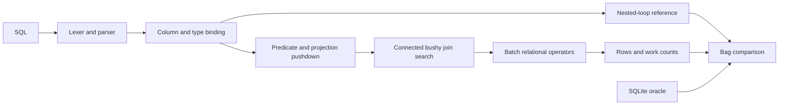

# Query Forge

Start with a query, then inspect the work its plan actually performs:

```sql
SELECT a.segment, COUNT(*) AS n, SUM(e.value) AS total
FROM accounts a JOIN events e ON a.id=e.account_id
JOIN marks m ON e.account_id=m.account_id
WHERE m.tag='keep' AND e.value>=10
GROUP BY a.segment;
```

The [saved plan comparison](explain/demo.json) returns the same two groups with both executors. The reference checks 100,644 nested-loop pairs. The optimized plan builds 31 hash rows and performs 805 probes. Projection pushdown materializes 2,568 cells instead of 5,132. Predicate applications increase from 99 to 1,204 because the filters run earlier; these counters are different kinds of work, not a latency ratio.

## Inspect a plan

```bash
python -m pip install -e .
python -m query_forge demo --output artifacts/plan-comparison.json
python -m query_forge explain --sql "SELECT COUNT(*) FROM events WHERE value IS NOT NULL"
python -m query_forge query --sql "SELECT account_id, SUM(value) FROM events GROUP BY account_id LIMIT 5"
python -m unittest discover -s conformance -v
```

Python 3.11+ and its standard library are sufficient. `--reference` selects the original join order and nested loops; `--batch-size` controls operator batches. The CLI uses a seeded catalog, while `Engine` and `Table` accept other typed input snapshots. SQL proposed by an agent follows the same parser and binder as any other input.

## Compilation and execution



The grammar covers selected columns or unqualified `*`, aliases, inner equijoins, comparisons, NULL predicates, boolean expressions, five aggregates, grouping, and LIMIT. It excludes ordering, outer joins, subqueries, DDL/DML, arbitrary functions, and text/numeric affinity coercion. Unsupported SQL fails instead of being delegated to SQLite or Python evaluation.

NULL comparisons yield UNKNOWN; filters keep TRUE only. Hash buckets exclude NULL keys and retain duplicate cross products. NULL grouping keys form one group. Empty global aggregates return one row with COUNT zero and other results NULL; grouped empty input returns no rows.

## When an aggregate refuses input

Join order can change both floating rounding and intermediate integer overflow. SUM/AVG therefore use exact accumulators with conservative order-stability certificates. INTEGER SUM bounds positive and negative subtotals separately. Floating aggregation requires a common binary grid whose scaled absolute subtotal fits 53 bits and whose absolute-value bound remains finite.

`1e16,-1e16,1` and some otherwise valid SQLite decimal sequences are rejected consistently by both plans. The certificate is intentionally narrower than arbitrary finite SQL aggregation. It prevents a join rewrite from silently changing the answer; the [SQL and numeric contract](manual/sql-and-numeric-contract.md) derives the rule.

LIMIT without ORDER BY also has no specified row choice. Differential checks enforce cardinality and duplicate-aware membership in the unlimited SQLite result rather than assuming its physical ordering.

## Repository guide

```text
src/query_forge/syntax.py        lexer, grammar and expression nodes
src/query_forge/engine.py        typed plans, DP search and batch operators
conformance/                    SQLite, NULL, duplicate and numeric cases
catalogs/                       seeded catalog reference
explain/                        actual plans and comparison reports
manual/                         grammar, optimizer math and findings
tools/review_mutations.py        targeted NULL and multiplicity regressions
tools/check_engine.py            repository checker
```

The [plan-work record](manual/plan-work-counts.md) includes 75 seeded differential queries, with catalog analysis reported separately. The [conformance findings](manual/conformance-findings.md) cover randomized checks and cancellation regressions. Operators exchange Python batches, not native SIMD vectors. Hash joins keep a build side in memory; there is no spill, index, distributed backend, or host resource sandbox.
