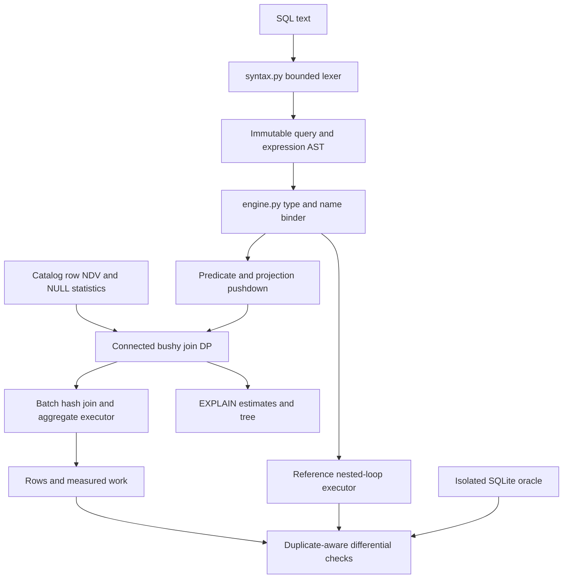

# Architecture

`syntax.py` lexes/parses a documented read-only SQL subset. `engine.py` binds typed columns, builds immutable relational nodes, searches join orders, and exchanges bounded batches. Scan projection controls actual materialized cells; hash buckets preserve duplicates and exclude NULL join keys. Grouping implements separate SQL aggregate/NULL rules.

SUM/AVG use exact integer/common-binary-grid accumulators and conservative order-independence certificates. Inputs that can produce overflow or rounding dependent on physical join order are rejected consistently; arbitrary finite SQLite aggregate compatibility is not claimed.

`experiments.py` constructs seeded catalogs, invokes both plan modes, and compares results with SQLite. SQLite is never a core execution fallback. EXPLAIN estimates are heuristic; work counters describe actual execution, and catalog analysis work is reported separately.

See [DESIGN](sql-and-numeric-contract.md) for grammar, DP cost equations, NULL semantics, operator complexity and limits; [REVIEW](conformance-findings.md) and [EXPERIMENTS](plan-work-counts.md) contain executed evidence.
